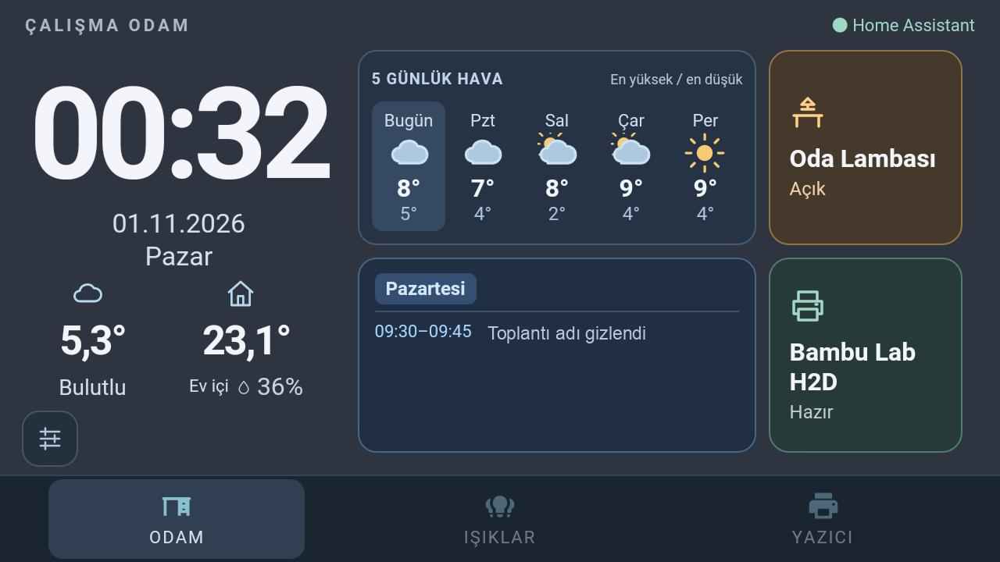
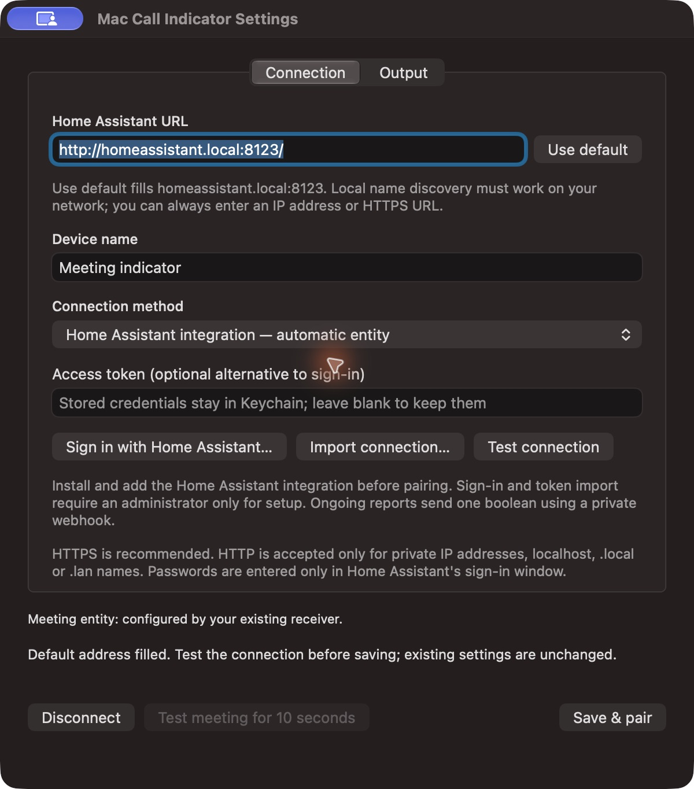
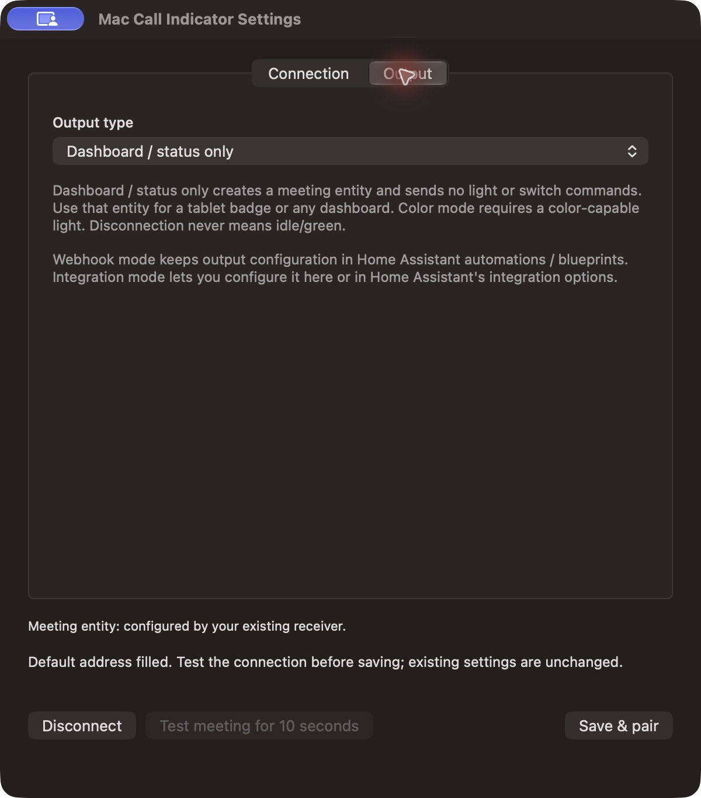
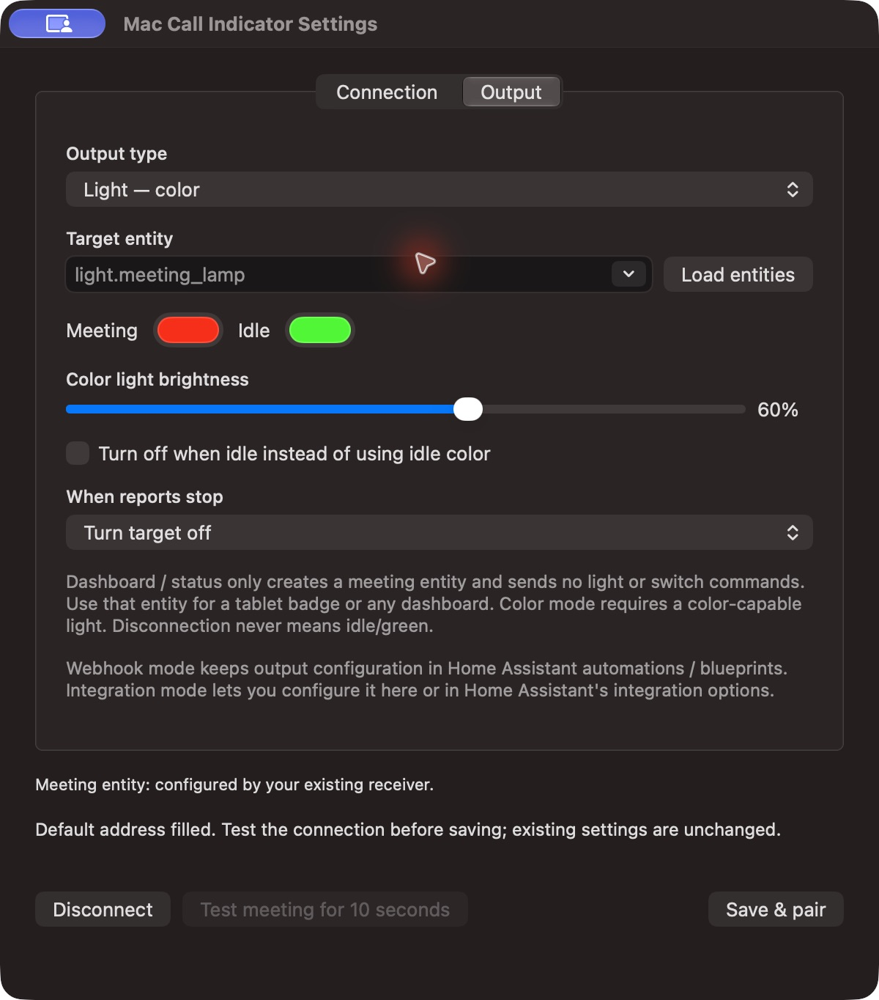
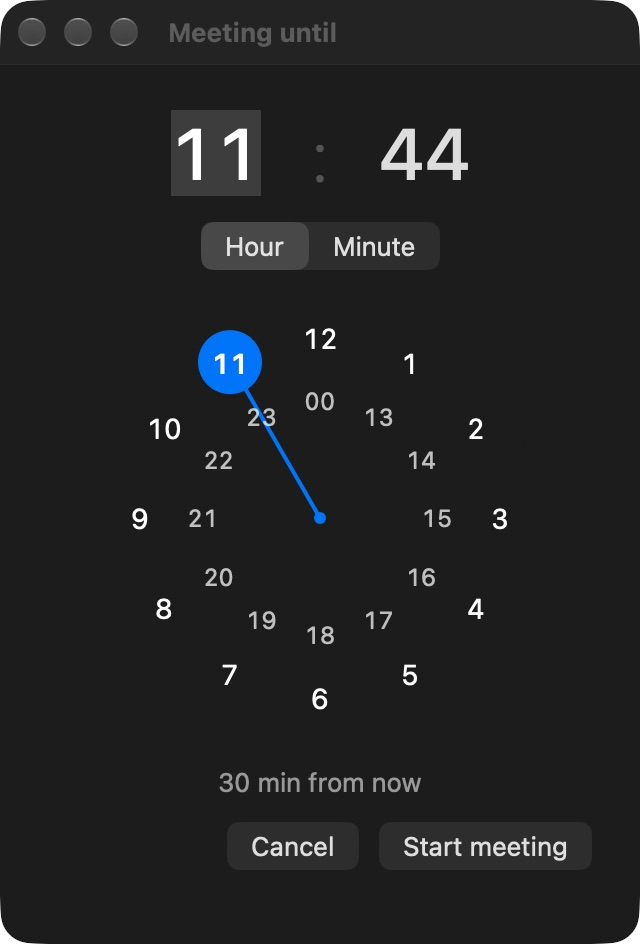
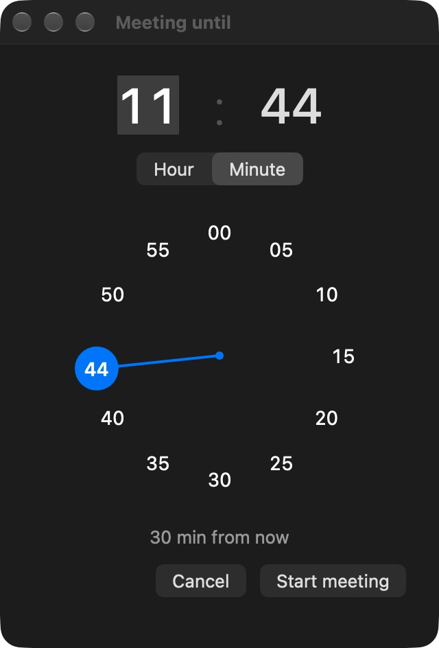
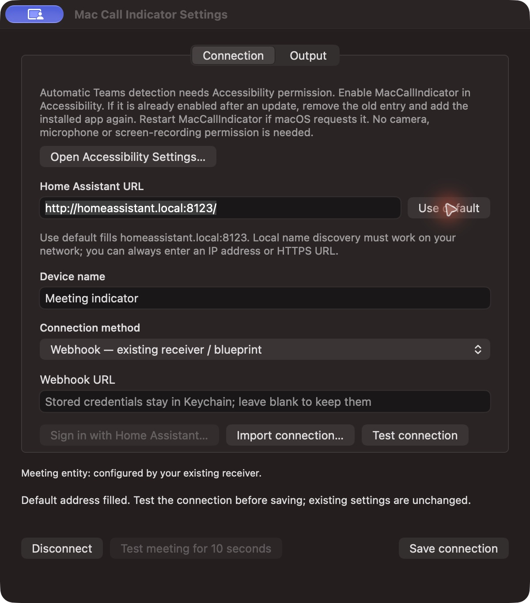

# Mac Call Indicator for Home Assistant

Turn your Mac's meeting status into a Home Assistant entity. Use it for a door-side
meeting lamp, an RGB desk light, a switch, an input boolean, or a dashboard badge.
No tablet is required.

The default call channel sends only `{"in_call":true}` or `{"in_call":false}`.
Participants, phone numbers and messages never leave the Mac. Optional Calendar
sharing sends selected meeting titles and times through a separate agenda channel;
it is disabled until you explicitly enable it.
Automatic detection currently targets Teams desktop; manual meeting timers work
independently of calls.

## What the app does

| Feature | What reaches Home Assistant | Setup |
| --- | --- | --- |
| Teams call detection | Meeting on/off with heartbeat | Optional Accessibility permission |
| Manual meeting timer | Same meeting source; independent deadline | 30 minutes, one hour, or a visual end-time picker |
| Optional workday agenda | Selected event titles and start/end times on a separate sensor | Optional Calendar permission and explicit sharing |
| Meeting lamp / helper | Your selected output behavior | Status only, on/off or color light, switch, input boolean |
| Offline handling | Source unavailable; configured safe target behavior | Freshness checked independently for calls and agenda |

## New in 0.4.0 preview

The [0.4.0 release candidate](https://github.com/kilinccagatay/mac-call-indicator/releases/tag/v0.4.0-rc.1)
adds an opt-in macOS Calendar agenda without Microsoft Graph or Entra app registration.
It reads one calendar already synced to the Mac, shares three selectable workdays,
and shows Monday on weekends. Calendar change notifications plus a one-minute
fallback refresh the local cache; delivery still depends on the upstream Calendar
account synchronizing its events.

Scheduled meetings can optionally contribute to meeting status. Real calls,
manual deadlines and scheduled meetings are independent: a call ending does not
cancel a manually reserved hour. The ordinary call channel remains boolean-only;
titles travel only through the separate, explicitly enabled agenda channel.

**Upgrade both packages:** install the matching Home Assistant integration ZIP and
restart HA before pairing the agenda. Keep the previous app/integration for rollback.
The preview is experimental: it is not a universal call detector or a guaranteed
meeting reminder. General macOS Now Playing/Plex control is **not included**.

[Calendar setup](docs/calendar-agenda.md) · [Home Assistant guide](docs/home-assistant.md) ·
[Release notes](CHANGELOG.md) · [Panel examples](https://github.com/kilinccagatay/home-assistant-legacy-panels)

This is an actual Samsung SM-J510FN screenshot. The meeting-title area alone was
covered for privacy and labelled “Toplantı adı gizlendi”; no real meeting title is
published. A tablet is optional: the meeting source can control a lamp or any
other Home Assistant automation instead.

## Choose your output

| Output type | During a meeting | Fresh idle report | Reports stop |
| --- | --- | --- | --- |
| **Dashboard / status only** | Source entity on; show your badge | Source entity off; hide it | Source entity unavailable; hide it |
| **Light — on/off** | Turn light on | Turn light off | Turn off, or explicitly leave unchanged |
| **Light — color** | Meeting color, red by default | Idle color, green by default, or off | Turn off or leave unchanged; never infer green |
| **Switch** | Turn selected switch on | Turn selected switch off | Turn off or leave unchanged |
| **Input boolean** | Turn helper on | Turn helper off | Turn off or leave unchanged |

The meeting **source** is a read-only binary sensor. The optional **target** is
an actuator/helper you choose. Dashboard mode needs no target and sends no light,
switch, or helper commands. A person entity or arbitrary read-only sensor is not
an actuator. Color mode accepts only color-capable lights.

The integration owns the target behavior; the Mac continues to report only a
boolean. Alternatively use status-only mode and a Home Assistant blueprint for
one or multiple outputs. Do not give both the integration and a blueprint control
of the same target.

## Quick start

1. Download the **universal macOS app** from [Releases](https://github.com/kilinccagatay/mac-call-indicator/releases),
   unzip it and move it to your Applications folder. Or build/install from source
   with `sh scripts/install.sh` (Xcode command-line tools, Swift 5.9+).
   The deployment target is macOS 13+. Grant Accessibility through normal settings if you want
   automatic Teams detection. Manual timers do not require that permission.
2. Install and add the [Home Assistant integration](docs/home-assistant.md#install-the-integration).
3. Open the Mac menu → **Settings… → Connection**. Enter your Home Assistant URL,
   or click **Use default** to fill `http://homeassistant.local:8123/`. This only
   fills the form; it does not save, sign in, or replace a saved connection.
   Local name discovery must work; an IP address or HTTPS URL can be entered instead.
4. Select **Home Assistant integration — automatic entity**. Sign in with Home
   Assistant, or import an access token on older installations. Pairing requires
   a Home Assistant administrator.
5. In **Output**, choose a mode. Leave **Dashboard / status only** selected for a
   dashboard badge. For an actuator, choose a matching entity using **Load entities**
   or type its entity ID. Color controls appear only in color mode.
6. Click **Save & pair**. The app displays the created meeting entity ID. Use
   **Test meeting for 10 seconds** to verify it, then test a real connected call.
   The receiver test requires Accessibility so it can return to a known detected
   state; existing manual timers and calls are never cancelled by testing.

Already using the original webhook setup? It keeps working without migration.
Select **Webhook — existing receiver / blueprint** to save its address in Keychain.
Use the [updated YAML receiver](examples/home-assistant.yaml) and the
[legacy setup guide](docs/home-assistant.md#existing-webhook-or-yaml-setup) for explicit
availability. Output configuration in webhook mode stays in Home Assistant.

## Settings and authentication

- **Connection:** Home Assistant address, Use default, generic device name,
  connection method, sign-in, private JSON import, and connection test.
- **Calendar (optional):** read permission, calendar selection, separate agenda pairing,
  explicit sharing, and independent scheduled-meeting indication.
- **Output:** dashboard-only, light on/off, color light, switch, or input boolean.
  Target domain and color capability are checked before pairing. Configure colors,
  brightness, idle-off, and disconnected behavior when applicable.
- **Credentials:** webhook URL, access token, and OAuth refresh token are stored
  in macOS Keychain. Ordinary preferences contain no credentials. Imports populate
  the form and require review/save; sign-in/token validation may store credentials.
- **Sign in with Home Assistant:** browser-based authorization with random state
  and PKCE S256. Your password stays in Home Assistant. Native sign-in requires
  a server advertising PKCE; older servers can use an imported long-lived token.
- **Disconnect:** stops reporting, clears local credentials for the selected server,
  and attempts OAuth refresh-token revocation. If the server is unreachable, revoke
  its session from your Home Assistant profile too. Imported long-lived tokens must
  be revoked manually in the profile when no longer needed.

See the [complete Home Assistant guide](docs/home-assistant.md) for import formats,
authentication permissions, pairing, network requirements, and troubleshooting.

| Connection and default address | Dashboard / status only | Optional color light |
| :---: | :---: | :---: |
|  |  |  |

These are isolated UI previews using example values, without signing in or
controlling a real device.

## Meeting lamp blueprints

Use these with a status-only source from this integration or the updated YAML
receiver. Both check the report timestamp; stale `off` is not verified availability.

- [On/off light, switch, or input_boolean](blueprints/automation/meeting_onoff.yaml)
- [Color meeting lamp](blueprints/automation/meeting_color.yaml): configurable busy
  and idle colors, brightness, idle-off, and disconnected behavior.

Import the corresponding GitHub file URL in Home Assistant → Settings →
Automations & scenes → Blueprints → Import blueprint. No lamp is controlled until
you choose a target and enable the automation. Dashboard-only use needs no blueprint.

## Availability and privacy

The Mac reports every ten seconds and on changes. The integration marks the source
**unavailable after 40 seconds** without a valid report and on Home Assistant startup.
The YAML receiver checks every five seconds, so expiry is normally 40–45 seconds.
Fresh false means idle; unavailable/unknown means no reliable information. If
Accessibility is revoked, automatic idle reporting stops; an explicit manual/test
meeting can still supply a positive state. The dashboard hides missing data.

Only these output domains are supported: `light`, `switch`, `input_boolean`.
The app does not request camera, microphone, screen recording, Contacts,
input monitoring, or Apple Events access. Optional agenda sharing requests Calendar
Full Access to read one selected calendar; events are never edited. Accessibility scans Teams controls,
skips editable fields, and does not read window titles. Busy status or microphone
activity alone does not trigger a meeting.

Pairing uses an authenticated, admin-only integration endpoint. Ongoing reports
use a random local-only webhook; its URL is a secret. Keep credentials, connection
imports, Home Assistant storage, and work-call screenshots out of Git. HTTPS is
recommended. The app allows HTTP only for private addresses, localhost, .local,
and .lan names, and refuses HTTP redirects. Being local does not itself encrypt traffic.

## Manual meetings

Open the Mac menu-bar icon to use these English menu options:

| Menu option | Behavior |
| --- | --- |
| **Meeting until…** | Opens the circular time picker; starts only after confirmation. |
| **30 min meeting** | Starts a manual meeting for 30 minutes immediately. |
| **1 hour meeting** | Starts a manual meeting for one hour immediately. |
| **End manual meeting** | Cancels only the manual timer; appears while one is active. |

### Circular time picker

The compact picker contains only an end time, a clock dial, a remaining-minutes
preview, and **Cancel / Start meeting**. There is no date picker.

| Hour selection · 24-hour dial | Minute selection · any minute |
| :---: | :---: |
|  |  |

Screenshots show the app's actual picker in an isolated local preview; no
meeting was started and no call information or credentials are included.

1. Click an hour on the dial or drag the clock hand to it. The outer ring is
   **1–12**; the inner ring is **13–23 and 00** for 24-hour time.
2. Release to move to minute selection, then click or drag to choose a minute.
   Any minute can be selected; the dial labels mark five-minute intervals.
3. Use **Hour / Minute** to switch between the two selections whenever needed.
4. Check the remaining minutes, then click **Start meeting**.

A keyboard is optional: click either number to type its value, or use the
up/down arrow keys. The dial also supports keyboard adjustment and accessibility
increment/decrement actions. Invalid input disables **Start meeting**. The
interface follows the Mac's light or dark appearance.

The picker uses the **next occurrence** of the selected local time. For example,
at 23:45, choosing 00:15 creates a 30-minute meeting. At 14:00, choosing 13:00
means 23 hours from now; check the preview to avoid an unintended long timer.

The app stores the absolute deadline locally and derives remaining minutes from
the Mac's clock, rounding up. It resumes an unexpired deadline after an app
restart. Expired deadlines are cleared automatically. The menu-bar icon shows
remaining minutes; the menu shows the end time and remaining minutes as well.

### Calls do not interrupt a manual meeting

Manual and detected-call states are independent: the reported boolean is true
when either is active. A Teams call starting or ending never cancels, resets, or
extends a manual deadline. Ending the manual timer also leaves an actual call
active. When the manual timer expires, automatic Teams detection continues.

For example, start **1 hour meeting**, then take a ten-minute Teams call.
Ending that call leaves the original manual deadline unchanged. If a Teams call
is still active when the manual timer expires, the dashboard indicator stays on
until that call ends.

Manual meetings do not require Accessibility. Manual end times and remaining
minutes are not sent to Home Assistant; the call payload remains a single boolean.
Optional calendar titles and times use a separately configured agenda receiver. An intentionally started manual timer is the explicit exception
to the connected-call requirement for automatic detection.

## Accessibility permission shortcut

If permission is missing, click **Accessibility permission required — Open Settings…**
in the menu bar. It opens the normal macOS Accessibility page. The same
**Open Accessibility Settings…** button appears under **Settings → Connection**,
with instructions. The warning disappears when permission is detected.

Enable **MacCallIndicator**. If it already appears enabled after an ad-hoc-signed
update, remove the old entry and add the current installed app again. Restart
the app if macOS requests it. Permission is never granted automatically; no
camera, microphone or screen-recording access is needed.

## Start at login

Use **Start at Login** in the Mac menu. It uses `SMAppService.mainApp`; new
installations default to off. Turning it off does not quit the app; **Quit** does
not change the login preference. macOS may request approval in Login Items.
The installer preserves an existing startup preference and migrates the old
project LaunchAgent. CLI options: `--login-status`, `--enable-login`, `--disable-login`.

## Dashboard example: an older Android tablet

A real-world example uses the meeting source to show **Toplantı** on an older
HoaryDash panel. It has no green/idle indicator and controls no lamp.

Follow the [HoaryDash guide](docs/hoarydash.md) or the separate
[older-hardware panel project](https://github.com/kilinccagatay/home-assistant-legacy-panels).
That project covers separate Denver and Samsung office profiles, lightweight
dashboards, printer views, forecasts and device-specific setup. It is
one optional consumer of the meeting entity.

## Validation and limits

- Swift tests cover detection, independent manual deadlines, clock input, output
  type validation, endpoint policy, PKCE, forged callback rejection and temporary tests.
- Isolated tests against Home Assistant **2025.3.4** cover config-entry/entity setup,
  authenticated HTTP pairing, boolean webhook reports, expiry, reload/unload, output
  commands, type checks, blueprints and legacy templates. No real lamp is switched
  by this suite. Newer Home Assistant versions still need their own validation.
- Native OAuth sign-in, token refresh, entity listing and admin pairing were
  validated on **Home Assistant 2026.10.0**. The older compatibility test server
  does not support native PKCE sign-in.
- A physical **Philips Hue Iris** (XY color mode) was tested through the installed
  Mac app: idle green → ten-second meeting red → idle green → off after reporter
  loss. The observer confirmed the physical colors. The source became unavailable;
  the previous lamp state and existing dashboard webhook were restored afterward.
- Teams **26183.1901.4874.5228** desktop test calls were validated while connected,
  muted and ended. Ordinary work meetings and other UI languages need validation.
  Phone/FaceTime detection is not enabled. This UI heuristic can break after Teams updates.
- The existing HoaryDash badge and stale-state removal were tested on an actual
  Denver TAC-70051. Clear its browser cache when dashboard changes do not appear.

Run Mac tests with `swift test`. Run Home Assistant tests in an isolated Python
3.13 environment using [tests_ha/requirements.txt](tests_ha/requirements.txt), then
`python -m pytest tests_ha`. The HA dependency is pinned for reproducibility, not
as a recommendation to downgrade a production server.

Ad-hoc-signed development updates can invalidate macOS Accessibility approval.
If the app reports permission required after restarting, remove its old entry
and add the current installed app in System Settings. Do not reset the entire
permission database. The actual app writes only `in_call` and
`observer_authorized` to its private App Support `status.json`; a terminal child
may inherit different permissions. No credentials or call details are logged.

## Downloadable release and packaging

The release includes a universal **Apple Silicon + Intel** app, the Home Assistant
integration ZIP, a screenshots ZIP and **SHA256SUMS.txt**. The app is **ad-hoc signed,
not Developer ID signed or Apple notarized**. macOS may block downloaded builds;
the source build is an alternative. No scripts disable Gatekeeper or remove quarantine.
The Apple Silicon build was exercised on the development Mac; the Intel slice is
cross-compiled and has not been run on physical Intel hardware.

For the calendar preview, check out tag `v0.4.0-rc.1` before building; `main`
continues to carry the stable implementation while the calendar PR is reviewed.
Run `sh scripts/package-release.sh` on a Mac to reproduce the packages. It builds
both architectures, strips debug symbols, verifies the ad-hoc signature and macOS
13 deployment targets, excludes user configuration, checks for private build
paths, and generates SHA-256 checksums. Generated packages stay in ignored dist/.

This remains an experimental project.
To uninstall, run `sh scripts/uninstall.sh`, revoke Accessibility, and remove the
Home Assistant integration/automations if no longer needed. Uninstalling does not
delete your private configuration or credentials automatically.

## Optional workday calendar

Show upcoming meetings from one calendar already synced to macOS Calendar in a
Home Assistant agenda with three selectable workdays. Weekends begin with Monday; Calendar change notifications plus
a one-minute fallback keep the local list current. Optional scheduled indication
combines with actual calls and manual timers without cancelling either source.
Sharing titles is a separate opt-in channel; the ordinary call report remains
boolean-only. See the [Calendar agenda guide](docs/calendar-agenda.md) for setup,
permissions, privacy and offline limitations.
